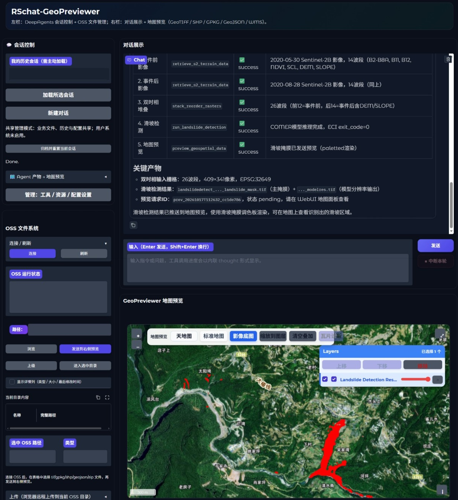
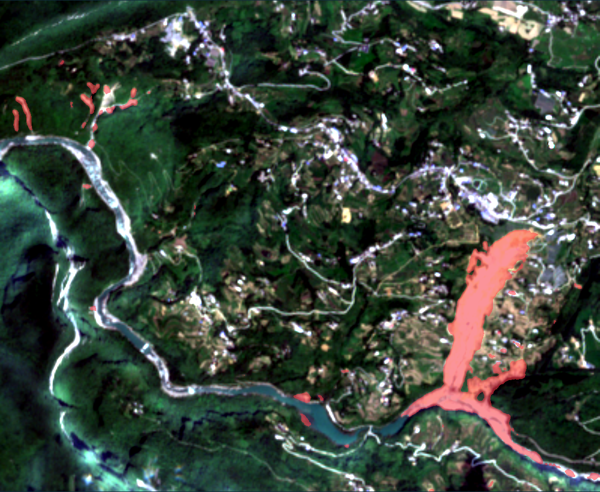
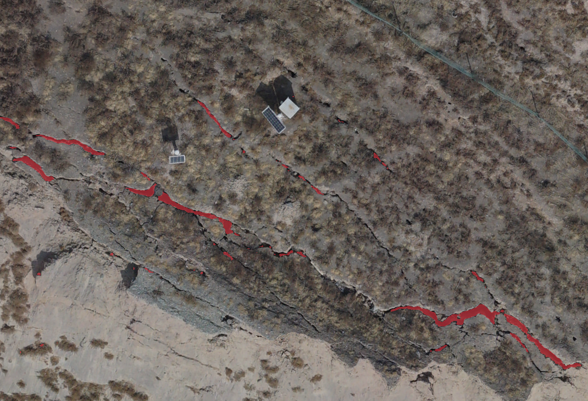

# GeoHazard Agent｜地质灾害遥感识别工作台

面向地质灾害遥感分析的 Agent 工作台，将自然语言任务、遥感数据处理、远程模型推理和地图成果查看连接起来，减少在独立脚本与 GIS 工具之间反复切换的操作。

**[项目展示](https://werk104.github.io/geohazard-agent-showcase/) · [在线体验](http://121.40.114.105:7860) · [个人负责部分](#个人负责部分)**

> 本仓库维护项目的静态展示网站，包含页面源码、公开展示素材及构建部署脚本；不包含完整后端服务、模型权重与运行环境。在线工作台为独立部署的服务。

## 项目概览

围绕“提出任务 → 获取数据 → 处理栅格 → 执行识别 → 查看成果”的业务流程，Agent 通过 MCP 调用地理处理工具，将各环节的输入、执行状态和成果引用串联起来。

- **任务组织**：使用自然语言描述研究区、时间范围与识别目标，组织多步骤工具调用。
- **数据准备**：衔接 Sentinel-2 影像、光谱指数与地形数据的获取、空间对齐和波段组合。
- **模型接入**：通过独立推理服务执行滑坡或裂缝识别，应用侧负责提交任务和接收成果。
- **成果查看**：在地图中叠加影像、矢量与预测掩膜，通过图层开关和透明度辅助人工检查。
- **过程追踪**：关联工具返回状态、输入来源与输出成果，便于复查处理过程。

## 工作台界面

工作台提供会话交互、工具执行信息、成果管理与地图预览。完整长截图和对应历史会话的公开摘要见[静态展示页](https://werk104.github.io/geohazard-agent-showcase/#interface)。

## 典型工作流

1. 输入研究区范围、事件前后时间及识别目标。
2. 分别获取前、后时相遥感数据，并补充所需指数与地形信息。
3. 对齐空间网格，按约定顺序堆叠输入通道。
4. 调用对应部署环境的模型推理服务。
5. 接收预测成果，并在地图中叠加检查与下载。

页面中的流程演示与图像比较为静态交互；实际数据处理及推理需进入独立在线工作台。

## 部署架构

| 部署方式 | 应用与计算的衔接 | 展示的任务范围 |
| --- | --- | --- |
| 局域网部署 | 应用侧与 MCP 工具通过远程 GPU API 上传数据、提交任务、轮询状态并接收成果 | 滑坡识别、RGB 裂缝识别 |
| OSS + ECI 云端部署 | 应用侧通过 OSS 衔接输入与输出，由 ECI 容器作业执行推理 | 滑坡识别 |

两种部署方式的工具集合与任务协议分别管理。架构图及说明见[系统架构](https://werk104.github.io/geohazard-agent-showcase/#architecture)。

## 案例成果

### 滑坡识别

展示事件前后 Sentinel-2 L2A 影像、预测掩膜及空间叠加结果。示例数据共 **26 通道**：

| 通道编号（从 1 开始） | 内容 |
| --- | --- |
| 1–10 | 事件前 B2、B3、B4、B5、B6、B7、B8、B8A、B11、B12 |
| 11–12 | 事件前 NDVI、SCL |
| 13–22 | 事件后 B2、B3、B4、B5、B6、B7、B8、B8A、B11、B12 |
| 23–24 | 事件后 NDVI、SCL |
| 25–26 | DEM、SLOPE |

26 通道为示例组合栅格的顺序；其中包含 SCL，具体模型输入仍按推理预设选择与处理。

### 裂缝识别

展示 RGB 输入影像与裂缝预测掩膜的叠加结果。

红色表示模型预测前景，不是人工标注真值。交互对比、二值预测图与素材处理说明见[案例成果](https://werk104.github.io/geohazard-agent-showcase/#results)及[案例素材文档](docs/DEMO_ASSETS.md)。

## 个人负责部分

在现有工程与团队协作基础上，主要负责 Agent 开发、MCP 工具体系接入及项目部署，具体职责如下。

1. **Agent 开发与任务编排**：负责遥感分析 Agent 的开发与工具调用流程集成，串联任务输入、工具执行和成果返回。

2. **MCP 工具封装与滑坡工作流开发**：负责项目全部 MCP 工具的封装，并开发滑坡识别工作流所需的数据获取、栅格堆叠与波段重排、推理调用和地图预览等工具。

3. **项目部署与服务联调**：负责局域网部署及 OSS + ECI 云端部署，完成应用、数据存储与推理服务之间的配置和联调。

## 主要技术

| 层级 | 技术与用途 |
| --- | --- |
| Agent 与任务组织 | Python、DeepAgents / LangGraph |
| 工具接入 | MCP |
| 地理数据处理 | GDAL、Rasterio |
| 交互与地图 | Gradio、OpenLayers |
| 推理与部署 | GPU API、Docker、OSS、ECI |
| 本展示网站 | HTML、CSS、JavaScript、Python 构建脚本、GitHub Pages |

## 仓库范围与网站维护

本仓库用于项目介绍与公开成果展示。克隆本仓库可查看和修改展示网站；运行完整 Agent 工作台还需要另行配置后端工程、工具服务、模型与数据环境。

- [网站更新、构建与部署说明](docs/WEBSITE_MAINTENANCE.md)
- [图片替换说明](docs/IMAGE_REPLACEMENT.md)
- [案例素材与通道说明](docs/DEMO_ASSETS.md)
- [工作台截图与历史会话摘要说明](docs/UI_SCREENSHOTS.md)

网页文案集中在 `content.json`，外部入口在 `config/site.json`，展示图片在 `assets/images/`。修改文案后由构建脚本生成 `index.html`；GitHub Actions 发布方式会自动执行构建。
